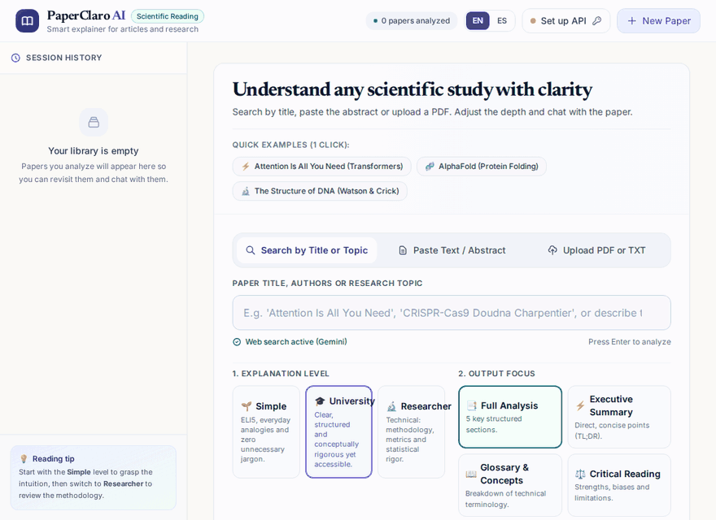

# PaperClaro AI

[English](README.md)

Explicador de papers científicos con IA. Busca un paper por título, pega su abstract o sube un PDF, y obtén una explicación en español adaptada a tu nivel, con chat para hacerle preguntas.

Es una aplicación 100 % de cliente: HTML, CSS y JavaScript, sin servidor ni cuentas. **Tú pones tu propia clave de API.**



*Ejecución real con un modelo local (Ollama, `qwen3.5:4b`).*

## Características

- Tres formas de entrada: título o tema, texto pegado o PDF/TXT (el PDF se lee en tu navegador).
- Tres niveles (sencillo, universitario, investigador) y cuatro enfoques (análisis completo, resumen, glosario, lectura crítica).
- Chat de seguimiento que mantiene el contexto del paper.
- Fórmulas matemáticas con KaTeX y exportación a Markdown.
- **Interfaz en inglés por defecto, con el castellano como alternativa.** Cambia con el selector EN / ES de la cabecera; la elección se recuerda en el navegador. El idioma también decide en qué idioma se genera la explicación y responde el chat.
- Varios proveedores: **Google Gemini, OpenAI, Anthropic (Claude), Grok (xAI), OpenRouter, Groq, Ollama (local), OpenCode (local)** y cualquier API compatible con OpenAI.
- Al introducir la clave, la app consulta al proveedor qué modelos tiene disponibles y los ofrece en un desplegable (también puedes escribir el nombre a mano).

## Uso

Sirve la carpeta con cualquier servidor estático (por ejemplo `python3 -m http.server 8000` y abre <http://localhost:8000>), pulsa **Configurar API**, elige proveedor y pega tu clave.

No hace falta compilar nada para usarlo (`dist/styles.css` está versionado). Sí necesita conexión a internet, porque la página carga `marked`, `DOMPurify`, KaTeX y PDF.js desde una CDN. Ábrelo a través de `localhost`, no con doble clic sobre `index.html` (`file://`), y añade `--bind 127.0.0.1` al comando si no quieres que otros dispositivos de tu red puedan acceder.

> La búsqueda web al pedir un paper por título solo está disponible con Gemini. Con el resto de proveedores el modelo responde con su propio conocimiento y puede equivocarse con papers poco conocidos: contrasta los datos importantes.

## Pruébalo gratis

Hay una copia en línea en <https://gotzon.viteri.eus/paperclaro/>. Sigues necesitando una clave, pero estos proveedores tienen plan gratuito (sin tarjeta; los límites cambian a menudo, consulta cada servicio):

| Proveedor | Clave gratuita | Notas |
|---|---|---|
| **Gemini** (el mejor para empezar) | [aistudio.google.com/apikey](https://aistudio.google.com/apikey) | Solo modelos Flash. En el plan gratuito Google puede usar tus prompts para mejorar sus productos: evita los papers confidenciales. |
| **OpenRouter** | [openrouter.ai/keys](https://openrouter.ai/keys) | Modelos que terminan en `:free`, con una cuota diaria pequeña compartida entre ellos. |
| **Groq** | [console.groq.com/keys](https://console.groq.com/keys) | Límites diarios. El catálogo gratuito cambia: si rechaza el modelo por defecto, elige otro de la lista. |

**OpenCode solo funciona en la versión local** (ver Uso), porque solo acepta páginas servidas desde `localhost`: en la copia en línea aparece en gris. **Ollama sí funciona en la copia en línea**, pero antes debe permitir ese sitio. Si responde y la rechaza, la app muestra el comando exacto; por ejemplo:

```bash
OLLAMA_ORIGINS=https://gotzon.viteri.eus ollama serve
```

Si Ollama corre como servicio, define `OLLAMA_ORIGINS` ahí (Linux: `sudo systemctl edit ollama`; macOS: `launchctl setenv OLLAMA_ORIGINS "https://gotzon.viteri.eus"`; Windows: una variable de entorno de usuario) y reinícialo. Chrome también puede pedirte permiso para acceder a tu red local.

## ¿Sin clave de API? Usa la skill

Una suscripción Claude Pro o Max no incluye clave de API, así que la app web no puede usarla. Para ese caso el repositorio incluye los mismos prompts como [Agent Skill](https://docs.claude.com/en/docs/claude-code/skills) en [`skill/paperclaro/`](skill/paperclaro/), que funciona dentro de Claude Code o claude.ai con tu suscripción:

- **Claude Code:** copia la carpeta a `~/.claude/skills/paperclaro/` (o a `.claude/skills/` dentro de un proyecto) y pide, por ejemplo, *"explícame este paper a nivel investigador: ~/papers/attention.pdf"*.
- **claude.ai:** comprime la carpeta `paperclaro` (`cd skill && zip -r paperclaro.zip paperclaro`) y súbela desde la sección Skills de los ajustes de claude.ai (el nombre del menú ha cambiado con el tiempo; requiere activar *Ejecución de código y creación de archivos*, y la disponibilidad depende de tu plan).

Ofrece los mismos tres niveles y cuatro enfoques de salida, responde en tu idioma (prompts en inglés o castellano) y sigue contestando preguntas de seguimiento. No hay panel de historial ni ventana de chat: es la conversación normal.

## Privacidad y seguridad

- Tu clave y el contenido de los papers van **directamente de tu navegador al proveedor que elijas**. No pasan por ningún servidor del proyecto.
- Por defecto la clave solo se guarda mientras la pestaña esté abierta. Si marcas "Recordar", se guarda **sin cifrar** en el almacenamiento del navegador: no lo hagas en un equipo compartido.
- Usa claves con límite de gasto cuando el proveedor lo permita.
- Las librerías externas se cargan desde CDN con versión fija y verificación de integridad (SRI). PDF.js y KaTeX solo se descargan cuando hacen falta.

## Desarrollo

Requiere Node.js solo para compilar el CSS de Tailwind.

```bash
npm install
npm run build   # genera dist/styles.css (minificado)
npm run watch   # recompila al editar
npm test        # ejecuta los tests (Node 22+)
```

`dist/styles.css` está incluido en el repositorio para poder publicar el sitio sin paso de compilación (por ejemplo, con GitHub Pages).

Estructura:

```
index.html          marcado de la página (textos en inglés, marcados con data-i18n)
src/i18n.js         traducciones (inglés / castellano), selector de idioma y prompts del modelo
src/app.js          lógica de la aplicación y capa de proveedores de IA
src/input.css       estilos propios + directivas de Tailwind
tailwind.config.js  configuración de Tailwind
dist/styles.css     CSS compilado
tests/              tests (node:test + jsdom)
.github/workflows/  CI: tests en Node 22 y 24, y comprobación de que dist/styles.css está al día
```

### Tests

`npm test` arranca el `index.html`, `src/i18n.js` y `src/app.js` reales en [jsdom](https://github.com/jsdom/jsdom) con un `fetch` simulado, así que no hace falta red ni clave de API (unos 6 segundos). Cubre:

- **Traducciones:** cada clave existe en los dos idiomas, los marcadores coinciden, no se cuela castellano en el código y existen todos los manejadores y ids.
- **Idioma:** inglés por defecto, cambio en caliente, elección recordada y que los prompts enviados al modelo siguen el idioma.
- **Proveedores:** formato de petición de Gemini, Anthropic y los compatibles con OpenAI (OpenAI, OpenRouter, Groq, Grok, Ollama, otras APIs), errores, reintentos y almacenamiento de la clave.
- **Modelos y URL base:** listado automático de modelos, selector único, Ollama local, normalización de URL y avisos.
- **Renderizado:** Markdown, protección de KaTeX y saneado de la salida del modelo (`marked` y `DOMPurify` se instalan en las mismas versiones que la página carga del CDN).

La CI (`.github/workflows/ci.yml`) ejecuta los tests en Node 22 y 24 y recompila el CSS para comprobar que el `dist/styles.css` del repositorio coincide con el código: si añades una clase de Tailwind, ejecuta `npm run build` y sube el resultado.

### Skill

`skill/paperclaro/` se genera a partir de los prompts de `src/i18n.js`: no la edites a mano. Tras cambiar un prompt ejecuta `npm run build:skill` y sube el resultado; un test falla si la skill está desactualizada.

### Traducciones

- Los textos estáticos están en `index.html`, en inglés. Un elemento se traduce marcándolo con `data-i18n="clave"` (se sustituye su HTML) y/o `data-i18n-attr="placeholder:clave; title:otra.clave"` (atributos). El texto inglés se lee de la propia página, así que no se duplica.
- Los textos construidos desde JavaScript (avisos, estados, etiquetas) y los **prompts que se envían al modelo** están en `src/i18n.js` y se leen con `t('clave', { vars })`.
- `I18N.es` debe contener todas las claves. Para añadir un idioma: añade su diccionario a `I18N`, su código a `LANGS` / `LOCALES` y un botón con `data-lang` y `class="lang-btn"` junto a los existentes.

> **Ollama (local):** no abras `index.html` con doble clic (`file://`): el navegador envía `Origin: null` y Ollama responde 403. Sirve la carpeta, p. ej. `python3 -m http.server 8000` y abre <http://localhost:8000> (Ollama acepta por defecto los orígenes `localhost`). Para otra dirección o un sitio HTTPS, arranca Ollama con `OLLAMA_ORIGINS` apuntando a ese origen.

> **OpenCode (local):** usa el [OpenCode](https://opencode.ai) que tienes en tu equipo, incluidos sus modelos gratuitos, así que no hace falta clave de API. Sirve la app desde `localhost` (igual que con Ollama) y:
>
> 1. `opencode service status` muestra la URL del servicio (`http://127.0.0.1:49374` por defecto; el puerto puede cambiar si el servicio se reinicia).
> 2. `opencode api POST /api/pair` muestra un código de emparejamiento (de un solo uso, válido 5 minutos).
> 3. En los ajustes elige **OpenCode (local)**, comprueba la URL y pega el código. Se cambia por un token (se guarda como una clave de API, ver *Privacidad*) y aparecen tus modelos, los gratuitos primero.
>
> Cada respuesta es una generación de texto simple a través de la API HTTP de OpenCode (sin herramientas ni ficheros), que OpenCode aún marca como experimental. La app crea una sesión llamada "PaperClaro AI" por modelo y la reutiliza; puedes borrarlas desde OpenCode. Los modelos gratuitos tienen los límites de uso de OpenCode, y cuando se agotan la app muestra su mensaje.

> **Ollama Cloud:** su API no admite llamadas directas desde el navegador (CORS). Para usar sus modelos, inicia sesión con `ollama signin` en tu Ollama local y elige el proveedor "Ollama (local)" con un modelo `-cloud`.

## Créditos y marcas

Los logotipos de los proveedores se muestran solo para identificarlos en el selector. Son marcas de sus respectivos propietarios (Google, OpenAI, Anthropic, xAI, OpenRouter, Groq, Ollama, OpenCode), con los que este proyecto no está afiliado ni respaldado. Los trazos SVG proceden de [Simple Icons](https://simpleicons.org) (CC0) y [LobeHub Icons](https://github.com/lobehub/lobe-icons) (MIT).

## Licencia

[Apache License 2.0](LICENSE). Copyright 2026 Potzon. Consulta [NOTICE](NOTICE).
